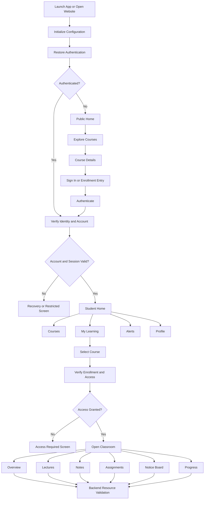
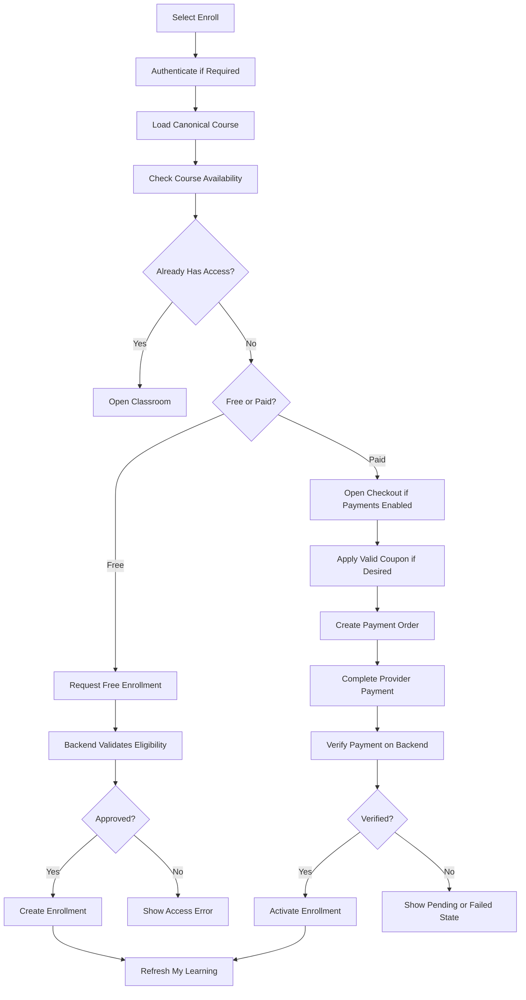
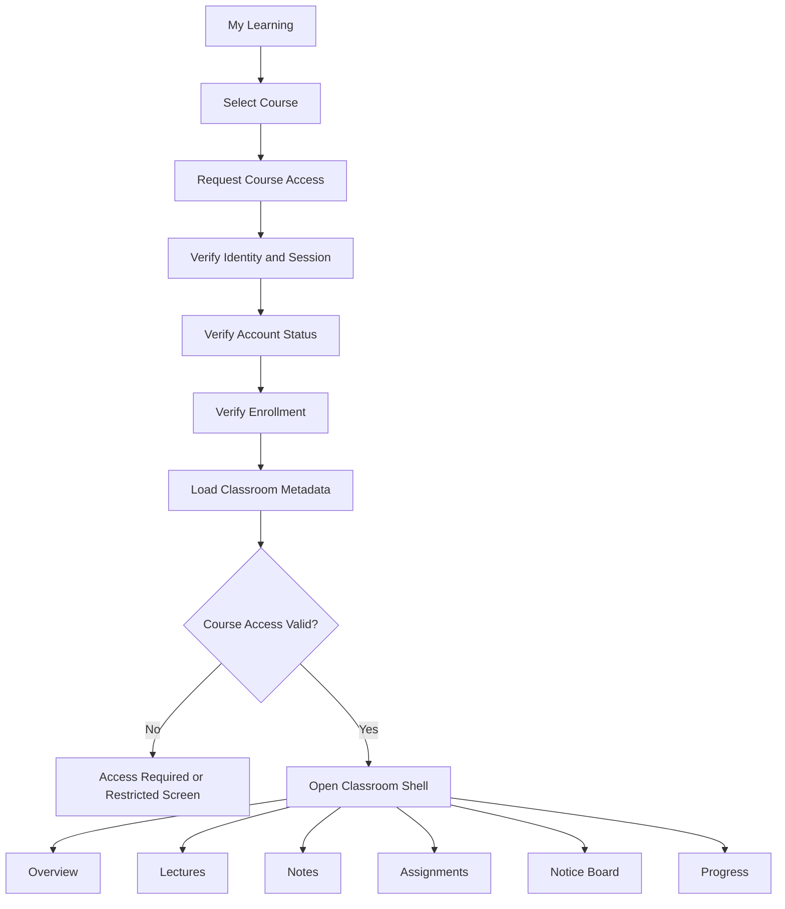
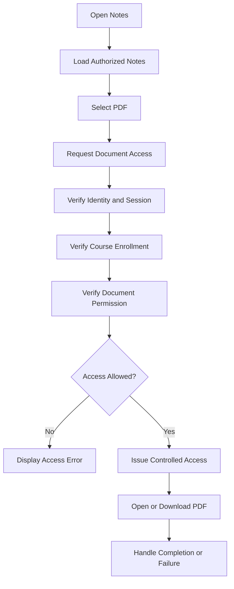
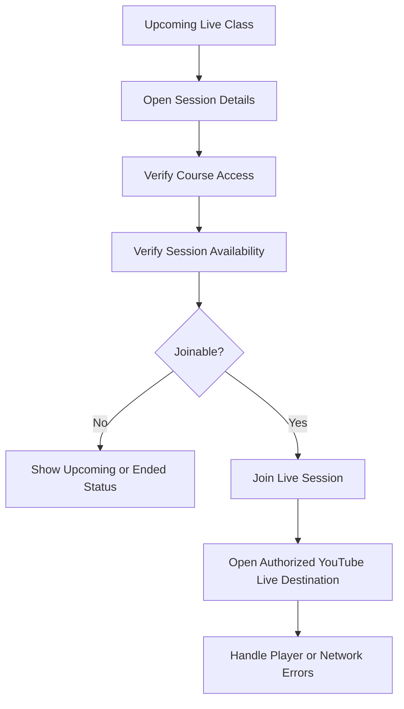
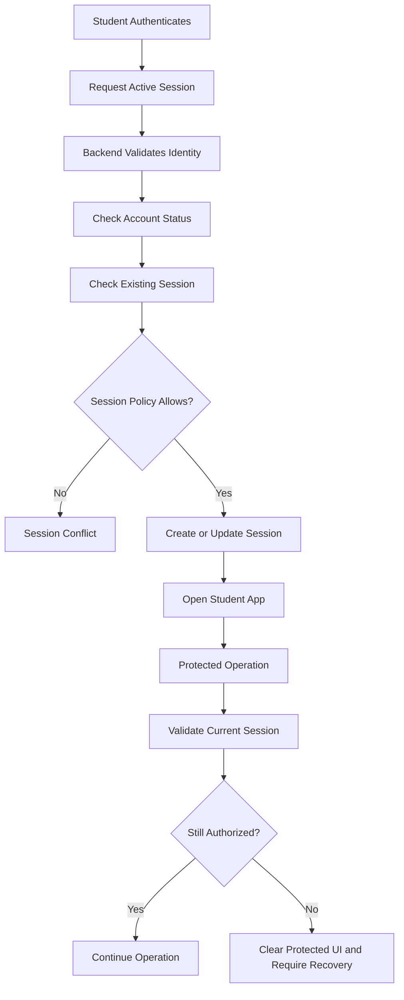

# AppFlow.md

# Bikash Bhaiya Classes

## Complete Application Flow, Screen Navigation, UI Behavior and System Interaction Specification

**Project Owner:** Bikash Chowdhury
**Development Agency:** DevSamp
**Document:** AppFlow.md
**Status:** Implementation Blueprint
**Platforms:** Android, iOS, Windows/Desktop Browser, Mobile Browser
**Mobile Stack:** React Native + Expo + TypeScript
**Web Stack:** Next.js + TypeScript
**Backend:** Firebase Authentication, Cloud Firestore, Cloud Functions, Firebase Cloud Messaging
**Video:** YouTube Video Player and YouTube Live
**Document Storage:** Google Drive with backend-controlled access

---

# 1. Purpose

This document defines the complete user journeys, screen transitions, navigation structure, interface behavior, and backend interactions for Bikash Bhaiya Classes.

The application must provide a polished educational experience inspired by the supplied UI reference images.

The reference design establishes the visual direction and screen composition. Its sample names, prices, ratings, courses, statistics, and other content are illustrative only. Actual production content must come from authorized project data.

This document covers:

* Application launch and onboarding.
* Authentication and account activation.
* Student home dashboard.
* Course discovery and filtering.
* Course details and curriculum.
* Enrollment and optional payment integration.
* My Learning.
* Separate classroom navigation.
* Lectures and video playback.
* Notes and PDF access.
* Assignments and tests.
* Notices and live classes.
* Progress tracking.
* Notifications.
* Profile and preferences.
* Single-active-device policy.
* Admin and teacher workflows.
* Responsive web navigation.
* Error handling and recovery.
* Accessibility, performance, and acceptance criteria.

Every implemented screen must have a defined entry point, expected actions, loading state, empty state, success behavior, failure behavior, and access-control requirements.

# 2. Product and Design Direction

## 2.1 Reference-Inspired Visual Language

The application must follow the supplied reference screenshots as the primary UI direction.

The visual system should feel:

* Modern and educational.
* Light, clean, and uncluttered.
* Premium without excessive decoration.
* Easy to navigate for school students.
* Consistent across Android, iOS, and web.
* Focused on content readability and learning progress.

### Color direction

Use a restrained palette based on the reference designs:

* Primary blue for main actions, active navigation, links, and progress.
* Very light lavender or cool off-white for the main background.
* White for cards, content surfaces, and dialogs.
* Dark charcoal for primary text.
* Muted grey for secondary text and metadata.
* Soft blue or lavender for selected filters and secondary surfaces.
* Green for successful completion and positive learning status.
* Amber for upcoming events or warnings.
* Red only for destructive actions, failed payments, and critical errors.

Create reusable design tokens instead of scattering hexadecimal colors across components.

The final color values must be defined centrally in `DESIGN.md` or the shared theme package.

## 2.2 Component Styling

Use:

* Rounded cards with consistent corner radii.
* Subtle borders or restrained shadows.
* Clear visual hierarchy.
* Consistent spacing.
* Readable typography.
* High-quality, consistent icons.
* Compact but understandable course metadata.
* Prominent primary actions.
* Consistent status indicators.
* Skeleton loaders that match the final content layout.

Avoid:

* Excessive gradients.
* Too many unrelated accent colors.
* Overly large empty areas.
* Excessive card nesting.
* Inconsistent corner radii.
* Unnecessary animations.
* Clipped text and buttons.
* Horizontally overflowing mobile layouts.
* Fake statistics or fabricated course information.

## 2.3 Reference Screens to Implement

The provided references represent these primary screens:

1. Course Explorer.
2. My Learning / Course Progress.
3. Student Profile.
4. Checkout.
5. Notifications.
6. Student Home.
7. Course Details and Curriculum.

These are required design references, not a restriction to only seven screens. Additional screens must use the same design system.

# 3. Application Navigation Architecture

The application has four navigation contexts:

1. Public navigation.
2. Authenticated student navigation.
3. Classroom navigation.
4. Administrative navigation.

Teacher navigation is optional and must remain disabled until its scope is approved.

## 3.1 Public Navigation

Public routes:

* Home.
* Courses.
* Course Details.
* Demo Class Information.
* Sign In.
* Sign Up.
* Password Recovery, if applicable.
* Privacy Policy.
* Terms and Conditions.
* Help and Support.

Public visitors can discover published courses without being granted access to protected learning material.

## 3.2 Student Main Navigation

The mobile bottom navigation should contain five destinations, following the reference designs:

| Destination | Purpose                                                  |
| ----------- | -------------------------------------------------------- |
| Home        | Learning summary, featured courses, and upcoming classes |
| Courses     | Explore, search, and filter courses                      |
| My Learning | Enrolled courses and learning progress                   |
| Alerts      | Notices, notifications, and reminders                    |
| Profile     | Student details, preferences, and support                |

Use a fixed bottom navigation bar on supported mobile layouts.

The selected destination must be visually distinguishable.

On desktop, this navigation may become a left sidebar or a compact top navigation, depending on viewport width.

## 3.3 Classroom Navigation

Opening a course from My Learning must switch to a separate classroom experience.

The main student navigation must not remain visible as the primary classroom navigation.

The classroom header must provide:

* Back to My Learning.
* Course title.
* Course or subject identifier.
* Notification access where appropriate.
* Optional overflow menu for supported course actions.

Classroom navigation must provide:

* Overview.
* Lectures.
* Notes.
* Assignments.
* Notice Board.
* Progress.

On mobile, use a compact tab row, scrollable tab strip, or another accessible layout when all tabs cannot fit.

On desktop, use a horizontal tab bar or a suitable side navigation.

The active classroom tab must remain visually clear.

## 3.4 Navigation Rules

* Use the router instead of manually manipulating browser history.
* Preserve valid destinations during authentication.
* Validate protected deep links before rendering protected data.
* Avoid duplicate navigation events during repeated taps.
* Display a loading state during route-dependent authorization.
* Prevent inaccessible screens from remaining visible after account suspension or session revocation.
* Confirm before destructive operations.
* Do not reset the user's current course position without a valid reason.
* Support browser back/forward navigation on web.

# 4. High-Level Application Flow



# 5. Application Launch and Session Restoration

## 5.1 Launch Flow

When the app opens:

1. Load the correct environment configuration.
2. Initialize Firebase.
3. Restore the authentication state.
4. Initialize the global error boundary.
5. Load essential application settings.
6. Verify the current account and session where required.
7. Resolve any incoming deep link.
8. Select the correct navigation context.
9. Render the destination.

The application must not briefly expose private course data while authentication is still being restored.

Optional services must not block the entire application if they fail.

## 5.2 Initial Loading Screen

Display a minimal branded loading screen.

It must:

* Use the approved academy logo.
* Avoid excessive animation.
* Prevent duplicate route changes.
* Display a recoverable error when initialization fails.
* Never show fabricated course data as if it came from the server.

## 5.3 Entry Destination

| User state                  | Destination                           |
| --------------------------- | ------------------------------------- |
| Guest                       | Public Home                           |
| Active student              | Student Home or a validated deep link |
| Pending activation          | Pending Activation                    |
| Suspended account           | Account Restricted                    |
| Invalid application session | Session Recovery                      |
| Active admin                | Admin Dashboard                       |
| Active teacher, if enabled  | Teacher Dashboard                     |

# 6. Student Home Screen

## 6.1 Purpose

The Home screen is the student's learning dashboard.

It must prioritize continuing existing learning before promotional content.

## 6.2 Layout Structure

Implement the following sections in order:

1. Welcome header.
2. Student greeting and profile shortcut.
3. Learning streak or summary, if supported by real data.
4. Continue Learning.
5. Upcoming Live Class.
6. Featured Courses.
7. Recent Notes and Tests, where available.
8. Recent Notices or Learning Alerts.
9. Mobile bottom navigation.

The design should follow the reference image with a light background, white cards, blue primary actions, and compact section headers.

## 6.3 Welcome Header

Display:

* Profile avatar.
* Greeting.
* Student's preferred display name.
* Notification icon.
* Optional streak or learning summary.

The avatar should use a valid profile image or a generated initials fallback.

Do not show an example user's personal information in production.

## 6.4 Continue Learning Card

Display when the student has an eligible course or lecture with learning progress.

Fields may include:

* Course title.
* Subject.
* Current lecture title.
* Completion percentage.
* Progress bar.
* Estimated duration, if available.
* Continue button.

The Continue action must resolve the last valid learning destination.

If the lecture is unavailable or access has expired, display a clear message and provide a route to the course overview.

Progress must be calculated from actual learning records. Do not invent completion percentages.

## 6.5 Upcoming Live Class

Display the nearest upcoming live session relevant to the student.

Include:

* Session title.
* Course or subject.
* Start time in the user's local timezone.
* Live/upcoming/ended status.
* Join or View Details action.

The Join button must become available only when the session is joinable under the configured schedule and access rules.

If no session exists, show a useful empty state rather than an empty card.

## 6.6 Featured Courses

Show a horizontal carousel or responsive card grid.

Course cards may include:

* Thumbnail.
* Course title.
* Class or subject label.
* Instructor name.
* Price, only if applicable.
* Published rating, only if backed by genuine data.
* Enrollment or Open Course action.

If the course is already accessible to the student, prioritize Open Course over Enroll.

## 6.7 Recent Notes and Tests

Show relevant recent learning items.

Possible item types:

* New note.
* Published PDF.
* Upcoming assignment.
* Available practice test.
* Newly published lecture.

Only show actions that are actually implemented.

If tests are outside the approved initial scope, do not render a non-functional Start Test button.

## 6.8 Home Screen State Handling

Support:

* Loading skeletons.
* First-time student state.
* No enrolled courses.
* No upcoming classes.
* Network failure.
* Partial content availability.
* Session revocation.
* Account restriction.

A failure in one dashboard section must not automatically hide all other successfully loaded sections.

# 7. Courses Explorer Screen

## 7.1 Reference Layout

The Courses screen should follow the first reference image.

Required layout:

1. Header and welcome context.
2. Explore Courses title.
3. Filter/settings action.
4. Search input.
5. Category chips.
6. Featured promotion or bundle banner, if configured.
7. Popular Courses section.
8. Sort or category controls.
9. Course card list.
10. Bottom navigation.

## 7.2 Search

The search input must support the fields approved for discovery, such as:

* Course title.
* Subject.
* Class level.
* Instructor name.

Search must provide:

* Input validation.
* Debounced search or an equivalent efficient strategy.
* Clear-search action.
* Loading feedback.
* No-results state.
* Network-error recovery.

Search queries must not cause unnecessary database reads on every keystroke.

## 7.3 Filters

Possible filter dimensions:

* Class 5–10.
* Class 11–12.
* Subject.
* Course type.
* Free or paid, if applicable.
* Availability.

The available filters must be derived from the actual catalog configuration.

Selected filters must be visually highlighted.

Users must be able to clear filters and return to the full eligible catalog.

Do not display categories that have no configured content unless product requirements explicitly request them.

## 7.4 Course Sorting

If sorting is enabled, use supported fields such as:

* Recommended.
* Recently added.
* Price.
* Popularity, only if popularity is defined and measured.
* Rating, only if genuine ratings exist.

Sorting must be deterministic when possible.

Do not use fake ratings, fake enrollment counts, or fabricated reviews to imitate the reference design.

## 7.5 Course Card

Each course card may include:

* Course thumbnail.
* Class or subject badge.
* Course title.
* Instructor name.
* Duration.
* Lecture count.
* Rating and review count, if genuine.
* Current price or Free label.
* Enrollment or Start Learning button.

Truncate long titles gracefully, but ensure the full title remains available on the details screen.

The card must have a clear clickable target and support keyboard access on web.

## 7.6 Course Action Rules

| Condition                 | Primary action                                   |
| ------------------------- | ------------------------------------------------ |
| Guest, free course        | View details or sign in to start                 |
| Guest, paid course        | View details or sign in to enroll                |
| Student without access    | Enroll or View Details                           |
| Student with valid access | Open Course                                      |
| Course unpublished        | Do not show in public catalog                    |
| Course archived           | Follow configured existing-student access policy |
| Account suspended         | Do not allow protected course access             |

## 7.7 Course Explorer Data States

Implement:

* Initial loading.
* Catalog loaded.
* Empty catalog.
* Empty filtered result.
* Search results.
* Search error.
* Filter error.
* Offline state.
* Partial image-loading failure.

Use image placeholders and fallback thumbnails where necessary.

# 8. Course Details Screen

## 8.1 Reference Layout

The Course Details screen should follow the final reference image.

Layout:

1. Back navigation.
2. Course header.
3. Course image or banner.
4. Class/subject badge.
5. Title.
6. Genuine rating, if available.
7. Instructor profile.
8. Course price or access status.
9. Primary enrollment action.
10. About section.
11. What You'll Learn.
12. Benefits or requirements.
13. Course Curriculum.
14. Chapters and lectures.
15. Sticky bottom action area on supported mobile layouts.

Tabs may include:

* About.
* What You'll Learn.
* Benefits.
* Curriculum.

Use scrollable tabs or an accessible alternative on narrow screens.

## 8.2 Course Information

The course details page must load the canonical published course record.

Display only fields that are configured and approved.

Avoid hardcoded sample content.

If optional metadata is missing, omit the field or show an appropriate fallback rather than inventing a value.

## 8.3 Curriculum

The curriculum may be organized into:

* Modules or chapters.
* Lectures.
* Notes.
* Assignments.
* Quizzes, if implemented.

Each module may display:

* Module title.
* Number of lectures.
* Estimated duration.
* Lock/access status.
* Expand/collapse control.

The curriculum must distinguish public preview items from protected items.

Clicking a locked lecture must not expose its video ID, protected document URL, or private content payload.

## 8.4 Preview

If preview lectures are enabled:

1. Student selects Preview.
2. The backend validates that the selected lecture is designated for public preview.
3. The player opens.
4. The student can return to Course Details.
5. The preview does not grant enrollment or access to the rest of the course.

## 8.5 Course Details State Handling

Support:

* Course loading.
* Course unavailable.
* Course not found.
* Course unpublished.
* Enrollment already active.
* Enrollment required.
* Preview unavailable.
* Network failure.

# 9. Enrollment Flow

## 9.1 Enrollment Entry Points

Enrollment may begin from:

* Course card.
* Course Details.
* Featured Course.
* Bundle offer.
* My Learning access-required screen.
* Administrator-issued enrollment invitation.

## 9.2 Enrollment Decision



## 9.3 Enrollment Rules

* Enrollment must be created through an authorized backend operation.
* Duplicate enrollment requests must be idempotent.
* Course availability must be rechecked at submission time.
* Client-provided prices must never be trusted.
* Course access must not be granted merely because a checkout screen reports success.
* Payment verification, if included, must occur on the backend.
* A failed request must not create duplicate enrollments.
* Enrollment changes must be reflected in My Learning.
* Existing course access must follow the approved suspension and refund policy.

## 9.4 Payment Scope

Payment integration is conditional on the final approved project scope.

If Razorpay or another payment provider is included:

* The backend creates the payment order.
* The provider processes the transaction.
* The backend verifies the result using the provider's supported verification mechanism.
* Enrollment is activated only after verified payment and eligibility checks.
* Repeated callbacks must not create duplicate entitlements.
* Pending payments must be shown as pending.
* Failed payments must offer a safe retry when permitted.

If payments are not part of the initial release, the enrollment screen must use the approved manual, invitation-based, or free-enrollment workflow.

Do not build a fake checkout flow that claims real payment success.

# 10. Checkout Screen

## 10.1 Reference Layout

When payment is enabled, follow the checkout reference image.

Sections:

1. Back button and Checkout title.
2. Course summary card.
3. Course title and instructor.
4. Coupon code input.
5. Apply Coupon action.
6. Price details.
7. Original price, when valid.
8. Discount, when valid.
9. Total payable.
10. Supported payment methods.
11. Terms and Privacy Policy consent.
12. Secure payment explanation.
13. Sticky bottom payment summary.
14. Proceed to Pay button.

The mobile checkout must keep the main action accessible without covering form fields.

## 10.2 Coupon Flow

1. Student enters a coupon code.
2. Client performs basic format validation.
3. Backend validates the coupon against the canonical course and student context.
4. Backend checks validity dates, redemption limits, eligible courses, and other configured conditions.
5. Backend returns the valid discount calculation.
6. UI refreshes the price summary.
7. Student may remove or replace the coupon.
8. The backend revalidates the coupon during final order creation.

The client must not calculate the authoritative final amount independently.

## 10.3 Price Summary

All values must be calculated from backend-approved pricing data.

Display:

* Original price, if configured.
* Discount, if applicable.
* Coupon discount, if applicable.
* Final payable amount.

Avoid showing a discount percentage unless the calculation supports it.

Do not claim a limited-time offer unless the offer actually has a configured end date or limitation.

## 10.4 Payment Failure and Recovery

Possible states:

* Order creation failed.
* Provider unavailable.
* User cancelled payment.
* Payment pending.
* Payment failed.
* Payment succeeded but verification is pending.
* Payment verified and enrollment activated.
* Duplicate callback received.

When the provider reports success but backend verification has not completed, display a processing state rather than claiming immediate enrollment.

The student must be able to refresh or check the payment status safely.

# 11. My Learning Screen

## 11.1 Purpose

My Learning is the student's personal course library.

It must display courses the student is entitled to access, along with relevant learning progress.

## 11.2 Layout

The screen should follow the second reference image.

Sections:

1. Compact student header.
2. My Learning title or contextual heading.
3. Enrolled course selector or course list.
4. Course progress summary.
5. Overall progress indicator.
6. Lecture, test, and notes summary where supported.
7. Continue Learning card.
8. Active module or chapter.
9. Upcoming classes and alerts.
10. Main navigation when outside a classroom.

## 11.3 Course Progress Summary

Display supported metrics such as:

* Completed lectures / total eligible lectures.
* Available notes count.
* Completed assignments / total assignments, if supported.
* Overall course completion.
* Current module.
* Last learning activity.

All values must come from actual records.

If the course contains no trackable items, show an appropriate message instead of dividing by zero or showing a fabricated percentage.

## 11.4 Continue Learning

When selected:

1. Load the latest valid progress record.
2. Verify enrollment and account status.
3. Resolve the next or last-viewed lecture.
4. Verify that the lecture is still available.
5. Open the classroom.
6. Navigate to the lecture or course overview as appropriate.

If the last-viewed lecture is unavailable, use a safe fallback and inform the student.

## 11.5 Empty State

If no courses are available:

* Explain that the student has no active courses.
* Provide an Explore Courses action.
* Offer enrollment support when appropriate.

Do not show a broken progress dashboard.

# 12. Classroom Entry and Navigation

## 12.1 Classroom Entry Flow



## 12.2 Classroom Shell

The classroom shell must be separate from the main application shell.

It must contain:

* Course header.
* Back-to-My-Learning action.
* Course identity.
* Classroom tabs.
* Current content area.
* Relevant course notices.
* Responsive layout.

On mobile, prioritize the course content and use compact tabs.

On desktop, use the available width for a structured content area while maintaining readable text and clear hierarchy.

## 12.3 Back Navigation

Back navigation must return the student to the appropriate prior context.

Preferred behavior:

* Return to the same My Learning list or course selector.
* Preserve the selected course and reasonable scroll position when possible.
* Avoid accidentally leaving the application when the user expects to leave the classroom.

Browser back must work without exposing unauthorized pages.

# 13. Classroom Overview

## 13.1 Purpose

The Overview tab summarizes the selected course and directs the student toward the next learning activity.

## 13.2 Layout

Include:

* Course progress card.
* Continue Learning button.
* Current or active module.
* Recently added lectures.
* Recent notes.
* Upcoming live classes.
* Upcoming assignments.
* Recent course notices.

Only show relevant and available sections.

## 13.3 Overview Actions

* Continue Learning opens the appropriate lecture.
* View All Lectures opens Lectures.
* View Notes opens Notes.
* Assignment Details opens the relevant assignment.
* Join Live opens the validated live-session destination.
* Notice Details opens the selected notice.

Each action must check resource availability before showing protected content.

# 14. Lectures and Video Playback

## 14.1 Lecture Listing

The Lectures screen must support:

* Module grouping.
* Lecture title.
* Duration, if configured.
* Locked/unlocked status.
* Completion status.
* Current lecture highlight.
* Preview status, where applicable.
* Search or filtering if approved.

The list must be generated from the course curriculum rather than manually duplicated in multiple screens.

## 14.2 Lecture Selection Flow

1. Student selects a lecture.
2. The client requests authorized lecture metadata.
3. The backend verifies identity and session.
4. The backend verifies enrollment and lecture availability.
5. The client receives permitted playback information.
6. The player screen opens.
7. Playback state is tracked according to the approved progress policy.
8. The student returns to the lecture list or continues to the next lecture.

## 14.3 Video Player Screen

The player must support:

* Play and pause.
* Fullscreen where supported.
* Playback error feedback.
* Retry where appropriate.
* Return to lecture list.
* Lecture title and course context.
* Available provider playback controls.
* Progress updates where supported.

Playback quality options such as 480p and 720p depend on the video provider, the available source renditions, device, and network conditions. Do not promise that every quality option will always be available.

The YouTube player may expose provider-controlled quality selection, but the application must not assume it can force every playback quality.

## 14.4 YouTube Integration Rules

* Store video identifiers and metadata in authorized backend records.
* Do not expose private administrative credentials.
* Use the supported YouTube player integration for each platform.
* Handle unavailable, removed, restricted, or region-limited videos.
* Respect the provider's terms and playback restrictions.
* Do not create unauthorized copies of provider video files.
* Do not falsely represent YouTube-hosted content as independently hosted video.

If a video cannot play inside a particular embedded context, show a clear fallback according to the approved product policy.

## 14.5 Progress Tracking

Progress may use:

* Last-viewed lecture.
* Playback position where supported.
* Completion status.
* Completed lecture count.
* Last activity timestamp.

The project must define what counts as a completed lecture.

Possible policies include a completion event from the player or a configurable watch-progress threshold. The chosen policy must be consistent across platforms.

Do not mark a lecture completed solely because the student opened it.

## 14.6 Video Error States

Support:

* Video unavailable.
* Network interruption.
* Playback initialization failure.
* Provider restriction.
* Expired or invalid access.
* Session revocation.
* Lecture unpublished.

A retry must not create duplicate progress records.

# 15. Notes and PDF Library

## 15.1 Notes Screen

The Notes tab must list authorized learning documents.

Possible content:

* Lecture notes.
* Chapter summaries.
* Formula sheets.
* Worksheets.
* Practice materials.
* Reference documents.

Each item may show:

* Document title.
* Related chapter.
* File type.
* Page count, if known.
* Publication date.
* Download availability.
* Download status.

## 15.2 PDF Access Flow



## 15.3 Google Drive Integration

Google Drive may be used as the underlying document storage provider.

The application must not expose private Drive credentials or service-account secrets to clients.

Documents must be private by default unless explicitly configured as public.

The backend must verify authorization before providing a document-access mechanism.

Use the approved document-serving strategy, such as a backend-mediated response or a short-lived access mechanism supported by the chosen architecture.

A long-lived publicly accessible Drive URL must not be treated as secure access control.

## 15.4 Download Flow

1. Student selects Download.
2. Backend checks current authorization.
3. The document-access service returns the permitted file response or access mechanism.
4. The client starts the download.
5. The UI displays download progress where supported.
6. The completed file is stored in the platform-appropriate location.
7. The UI reports success or failure.

The app must not display Download Complete before the file has actually been saved.

## 15.5 Offline Files

If offline downloads are included:

* Store files in an appropriate platform-managed location.
* Maintain a local record of downloaded items.
* Handle interrupted downloads.
* Detect duplicate downloads.
* Provide a delete/download-again action.
* Reconcile local records with server authorization.
* Avoid exposing downloaded files through unrelated application areas.

Already-downloaded files cannot reliably be recalled remotely. The interface must not promise that revoking course access will erase copies already saved or exported by a student.

## 15.6 PDF States

Support:

* No notes available.
* Document loading.
* Download in progress.
* Download completed.
* Download failed.
* Document unavailable.
* Permission revoked.
* Offline access unavailable.
* File type unsupported.

# 16. Assignments and Tests

Assessment functionality must be enabled only for features approved for the release.

## 16.1 Assignment Listing

Each assignment may display:

* Title.
* Course or module.
* Instructions summary.
* Due date.
* Submission status.
* Marks or feedback status, where supported.
* Open Details action.

## 16.2 Assignment Detail

Display:

* Assignment title.
* Instructions.
* Due date and timezone.
* Allowed submission format.
* Submission deadline.
* Previous submission status.
* Available submission actions.

## 16.3 Submission Flow

1. Student opens an assignment.
2. Backend verifies assignment visibility and course access.
3. Student reviews the instructions.
4. Student selects an allowed submission method.
5. The client validates basic file type and size.
6. The backend validates authorization and submission constraints.
7. The submission is recorded.
8. The UI displays the authoritative submission result.

The backend must decide whether late submissions, resubmissions, or replacements are permitted.

Repeated submissions must follow a clearly defined policy.

## 16.4 Test Flow

If tests or quizzes are included:

* Load the published test definition.
* Verify access and availability window.
* Create or resume an attempt according to policy.
* Record answers using authorized operations.
* Prevent duplicate finalization.
* Calculate results on the backend when required.
* Show the result only when the release policy permits it.

Do not claim a full examination system is implemented if the project includes only downloadable worksheets.

# 17. Notice Board and Live Classes

## 17.1 Notice Board

The Notice Board must list relevant course notices.

Each notice may include:

* Title.
* Summary.
* Publication time.
* Optional attachment.
* Priority.
* Expiry or archive state, if configured.

Opening a notice must show its full authorized content.

Archived notices must follow the configured retention and visibility policy.

## 17.2 Live-Class Flow



## 17.3 OBS and YouTube Live

The intended streaming workflow may be:

`Teacher/Operator → OBS → YouTube Live → Student Player`

OBS sends the stream to YouTube using the configured stream setup.

Students join through the application using the approved YouTube playback integration.

The student app must never expose a stream key or other broadcasting credentials.

The administrator must be able to publish the relevant session information and manage availability.

A live session must not appear as joinable merely because a URL exists.

## 17.4 Live-Class States

Support:

* Scheduled.
* Starting soon.
* Live.
* Ended.
* Cancelled.
* Unavailable.
* Playback error.

Times must be displayed consistently with the configured timezone.

# 18. Student Progress

## 18.1 Progress Dashboard

The Progress tab must show only meaningful, supported metrics.

Possible metrics:

* Course completion.
* Completed lectures.
* Remaining lectures.
* Assignment completion.
* Test results, if implemented.
* Last learning activity.
* Chapter-wise progress.

## 18.2 Progress Calculation

The project must define a single canonical progress calculation.

For example, when lecture completion is the approved metric:

`Course Progress = Completed Eligible Lectures / Total Eligible Lectures × 100`

This formula is illustrative and must be adapted if the product defines weighted chapters or additional activities.

Rules:

* Exclude unpublished items from the eligible total.
* Handle empty courses safely.
* Prevent duplicate completion events.
* Keep progress consistent across platforms.
* Do not allow the client to arbitrarily set completion percentages.
* Recalculate or reconcile progress when curriculum eligibility changes.

## 18.3 Certificates and Streaks

Certificates and learning streaks shown in the reference designs must be implemented only if the required business rules exist.

If certificates are included, define:

* Eligibility.
* Issuance.
* Unique certificate identity.
* Verification.
* Revocation or correction policy.

If streaks are included, define the qualifying activity and timezone rules.

Do not display placeholder achievements as real student achievements.

# 19. Notifications and Alerts

## 19.1 Reference Layout

The Notifications screen should follow the supplied reference image.

Include:

* Header and back action.
* Mark All as Read.
* Filter chips.
* Notification cards.
* Unread indicators.
* Timestamps.
* Contextual action buttons.
* Empty and loading states.

Possible filters:

* All.
* Unread.
* Announcements.
* Academic.
* Live Classes.
* Assignments.
* Account or billing events, if enabled.

The final categories should reflect the actual notification model.

## 19.2 Notification Types

Possible notification events:

* New lecture published.
* New notes uploaded.
* Upcoming live class.
* Live class started.
* Assignment published.
* Assignment deadline reminder.
* New course notice.
* Course enrollment confirmed.
* Payment status updated, if payments are enabled.
* Account or session warning.
* Administrative announcement.

Only relevant events should be sent to each student.

## 19.3 Notification Interaction

When a notification is selected:

1. Mark it as read where appropriate.
2. Resolve its associated destination.
3. Verify that the destination still exists.
4. Verify authorization.
5. Navigate to the target.
6. Show a fallback if the content has expired or is unavailable.

Notification payloads must not contain sensitive student data or privileged URLs.

## 19.4 Push Notifications

Use Firebase Cloud Messaging where supported and configured.

Push notification delivery must be treated as best-effort, not guaranteed.

The app must also retrieve authoritative in-app notification records when opened.

Handle:

* Permission not granted.
* Notification token refresh.
* Invalid or expired device token.
* Duplicate delivery.
* User sign-out.
* Multiple platform installations.
* Notification opened from a terminated application.

The backend must target the appropriate student and permitted devices.

# 20. Student Profile

## 20.1 Reference Layout

The Profile screen should follow the third reference image.

Sections:

1. Profile header.
2. Avatar and profile information.
3. Edit Profile Details.
4. Student summary cards, if supported.
5. Academic Details.
6. My Certificates and Achievements, if implemented.
7. Downloaded Lectures, if offline functionality is implemented.
8. Notifications and Study Reminders.
9. Help and Support.
10. Privacy Policy and Terms.
11. Sign Out.

## 20.2 Profile Data

Display only approved profile fields, such as:

* Student display name.
* Verified email or phone, where appropriate.
* Class or academic level.
* Batch or cohort.
* Profile image.

Do not display sample contact details or another student's information.

## 20.3 Edit Profile

The edit flow must:

1. Load the student's current profile.
2. Allow editing only permitted fields.
3. Validate input.
4. Submit changes through the authorized operation.
5. Show field-level errors.
6. Update the profile after server confirmation.
7. Preserve existing values when optional updates fail.

Sensitive identity fields must follow the approved verification policy.

## 20.4 Academic Details

If enabled, the screen may include:

* Class or grade.
* Board.
* Stream or subject group.
* Academic year.
* Batch.

Only authorized fields may be edited by the student.

## 20.5 Downloaded Lectures

If offline media or files are supported, show:

* Downloaded item.
* Download status.
* File size where available.
* Last sync status.
* Remove Download action.

Do not promise offline video downloads when the chosen video provider or implementation does not support them.

## 20.6 Settings and Support

Provide:

* Notification preferences.
* Study reminders, if implemented.
* Help and Support.
* Privacy Policy.
* Terms and Conditions.
* Sign Out.

Settings must persist through an approved backend or platform-appropriate local preference mechanism.

# 21. Account Status and Recovery Screens

Create dedicated screens or dialogs for:

* Pending activation.
* Account suspended.
* Enrollment required.
* Session conflict.
* Session expired.
* Course access revoked.
* Course unavailable.
* Network unavailable.
* Application maintenance.
* Unsupported app version, if version enforcement is implemented.

Each screen must clearly explain:

1. What happened.
2. What the student can do.
3. Whether retrying is appropriate.
4. Whether support is required.
5. How to return to a safe destination.

Do not expose internal exception traces or security details.

# 22. Single-Active-Device Flow

## 22.1 Policy

The product requirement is one active student session across supported platforms.

The exact second-device behavior must be configured and documented.

Recommended initial policy: reject a new active session while another valid session exists, unless an administrator resets the session or the approved product policy explicitly allows replacement.

## 22.2 Session Lifecycle



## 22.3 Security Rules

* The backend creates authoritative session records.
* Session identifiers must not be accepted as proof of identity by themselves.
* Protected operations must validate the active session.
* Session revocation must prevent new protected operations.
* Client-side route guards are not a replacement for backend authorization.
* Firebase ID-token validity alone does not establish that an application-specific session remains active.
* Session updates must handle concurrent sign-in attempts safely.

## 22.4 Administrator Reset

Flow:

`Admin Dashboard → Student Details → Active Session → Revoke → Confirm → Server Validation → Audit Event`

After revocation, protected operations must be denied according to the defined enforcement policy.

The student client must clear protected UI and guide the user through reauthentication.

Already downloaded files cannot be reliably recalled.

# 23. Responsive Design: Android, iOS and Web

## 23.1 Mobile Layout

For phones:

* Use a single-column layout.
* Keep cards within the available width.
* Use a fixed bottom navigation where appropriate.
* Use scrollable filter chips.
* Keep primary actions accessible.
* Respect safe areas and system insets.
* Support keyboard-aware forms.
* Avoid clipped labels and buttons.
* Use suitable touch-target sizes.
* Support system text scaling where practical.

## 23.2 Tablet Layout

For tablets:

* Use wider cards where appropriate.
* Consider two-column course grids.
* Preserve the mobile-friendly classroom structure.
* Avoid excessive stretching of text lines.
* Use available space without making navigation ambiguous.

## 23.3 Windows/Desktop Web

For desktop browsers:

* Use a responsive top navigation or sidebar.
* Use multi-column course grids where suitable.
* Give the classroom a wider content layout.
* Keep video, notes, and course navigation organized.
* Use keyboard-accessible controls.
* Provide visible focus states.
* Support browser back/forward navigation.
* Avoid mobile-only fixed positioning that breaks desktop layouts.

## 23.4 Breakpoint Behavior

Define shared responsive breakpoints in the design system.

Do not hardcode unrelated breakpoints in individual screens.

Test at minimum:

* Small phone.
* Standard phone.
* Large phone.
* Tablet.
* Narrow desktop.
* Standard desktop.
* Wide desktop.

The exact breakpoint values must be centrally configured.

# 24. Admin Panel Flow

The administration panel is a separate web application or clearly separated administrative application area.

Only authorized administrators may access administrative functions.

## 24.1 Admin Navigation

Recommended modules:

* Dashboard.
* Students.
* Courses.
* Subjects and Modules.
* Lectures.
* Notes and Documents.
* Live Classes.
* Assignments.
* Notices.
* Coupons.
* Enrollment.
* Payments, if enabled.
* Notifications.
* Sessions and Access Control.
* Audit Logs.
* Settings.

Unapproved or incomplete modules must not appear as operational features.

## 24.2 Admin Dashboard

Display operational summaries derived from real data, such as:

* Total active students.
* Published courses.
* Upcoming live classes.
* Pending submissions.
* Recent operational events.
* Failed imports or content-processing tasks.

Do not fabricate business metrics.

## 24.3 Student Management

Flow:

`Student List → Search/Filter → Student Details → Approved Action → Confirmation → Backend Operation → Updated Record`

Actions may include:

* Create or invite student.
* Edit permitted student details.
* Activate account.
* Suspend account.
* Assign or revoke course access.
* Reset active session.
* Review relevant audit history.

High-impact operations must require explicit confirmation.

## 24.4 Initial Student Import

The import process must:

1. Validate the file format.
2. Validate required columns.
3. Normalize allowed fields.
4. Detect duplicate identifiers.
5. Identify invalid records.
6. Process valid records safely.
7. Produce a summary of imported, skipped, and failed records.
8. Allow an authorized operator to review errors.
9. Prevent accidental creation of duplicate student accounts.

Do not import passwords or unnecessary sensitive data from spreadsheets.

## 24.5 Course Management

Course workflow:

`Draft → Validate → Publish → Available in Catalog`

A published course may later be archived or unpublished according to policy.

The system must distinguish:

* Public catalog visibility.
* Enrollment eligibility.
* Existing student access.
* Classroom content availability.

Unpublishing a course must not silently produce inconsistent enrollment or payment records.

## 24.6 Content Management

The admin must be able to manage supported content types.

For each content item:

* Validate required metadata.
* Associate it with the correct course or module.
* Set publication status.
* Configure preview/access policy.
* Save changes.
* Publish only after validation.

Deleting or replacing content must follow the configured data-retention and student-progress policy.

## 24.7 Live-Class Management

The admin may:

* Create a scheduled session.
* Associate the session with a course.
* Set the start time.
* Configure the approved playback destination.
* Publish the session.
* Mark it cancelled or ended.
* Notify relevant students.

The backend must not expose broadcasting credentials.

## 24.8 Notification Management

Before sending an announcement:

* Validate the message.
* Select the authorized audience.
* Confirm the destination.
* Prevent accidental duplicate sends where possible.
* Record the action in an audit log.
* Report the actual processing result.

## 24.9 Admin Audit Events

Audit relevant actions, including:

* Role or permission changes.
* Account activation or suspension.
* Enrollment changes.
* Session revocation.
* Course publication changes.
* Coupon changes.
* Payment-related administrative actions, if enabled.
* Bulk imports.
* Important content deletion or replacement.

Audit records must be protected from unauthorized modification.

# 25. Teacher Flow

Teacher functionality is optional and must be approved before implementation.

If enabled:

1. Teacher signs in.
2. Backend verifies the teacher role.
3. Backend loads assigned courses.
4. Teacher opens an assigned course.
5. Teacher manages permitted content or assessments.
6. Backend verifies course-level permissions.
7. The operation is recorded where required.

Teachers must not be able to modify global administrator settings unless explicitly authorized.

# 26. Backend Interaction Rules

## 26.1 Common Request Lifecycle

Every protected operation must follow this pattern:

1. Validate the input shape.
2. Authenticate the caller.
3. Verify the application session when required.
4. Resolve the caller's account status.
5. Check role and resource permissions.
6. Validate business rules.
7. Execute the operation safely.
8. Record required audit information.
9. Return a structured response.
10. Map failures to understandable UI states.

## 26.2 Suggested Response Categories

Use consistent error codes, such as:

* `UNAUTHENTICATED`
* `ACCOUNT_PENDING`
* `ACCOUNT_SUSPENDED`
* `SESSION_CONFLICT`
* `SESSION_REVOKED`
* `PERMISSION_DENIED`
* `COURSE_NOT_FOUND`
* `COURSE_UNAVAILABLE`
* `ENROLLMENT_REQUIRED`
* `RESOURCE_UNAVAILABLE`
* `VALIDATION_FAILED`
* `COUPON_INVALID`
* `PAYMENT_PENDING`
* `PAYMENT_FAILED`
* `RATE_LIMITED`
* `NETWORK_UNAVAILABLE`
* `INTERNAL_ERROR`

These are suggested application-level codes, not assumed built-in Firebase error codes.

## 26.3 Retry Rules

Retry operations only when appropriate.

* Safe read operations may be retried.
* Idempotent writes may be retried according to their contract.
* Payment creation and submission operations must use idempotency protections where required.
* Do not automatically repeat destructive operations.
* Do not turn a timeout into a false success message.

# 27. Deep Links and Notification Destinations

The application must support approved internal destinations such as:

* Course Details.
* Classroom Overview.
* Lecture.
* Notes.
* Assignment.
* Notice.
* Live Session.
* Profile Settings.

When a deep link is opened:

1. Validate its structure.
2. Resolve authentication.
3. Resolve the intended account role.
4. Verify the resource.
5. Verify access.
6. Navigate to the destination.
7. Display a fallback if the destination is invalid.

Deep links must not bypass course authorization.

Avoid redirecting users to arbitrary external URLs supplied in query parameters.

# 28. Data and State Management

## 28.1 Server State

Server-controlled data includes:

* User account status.
* Course catalog.
* Enrollment.
* Course content.
* Document permissions.
* Assignment definitions.
* Submission status.
* Notices.
* Live-class status.
* Coupon eligibility.
* Payment verification.
* Active session state.

Use a consistent data-fetching and caching strategy.

## 28.2 Local UI State

Local state may include:

* Search input.
* Selected filters.
* Expanded curriculum sections.
* Temporary dialog visibility.
* Current tab.
* Form input before submission.
* Playback UI state.

Local UI state must not be used as authoritative proof of enrollment, payment, or permissions.

## 28.3 Cache Invalidation

Invalidate or refresh relevant data after:

* Enrollment activation.
* Enrollment revocation.
* Course publication changes.
* Session revocation.
* Account suspension.
* Assignment submission.
* Notice publication.
* Document permission changes.
* Payment verification.

A cached screen must not continue presenting access as valid after a known authorization failure.

# 29. File and Module Organization

The codebase must remain modular and easy to maintain.

Recommended structure:

```text
apps/
  student-mobile/
    app/
      (public)/
      (auth)/
      (student)/
      classroom/
      profile/
    src/
      features/
        auth/
        home/
        courses/
        enrollment/
        learning/
        classroom/
        lectures/
        notes/
        assignments/
        notices/
        notifications/
        profile/
        sessions/
      components/
      navigation/
      services/
      hooks/
      state/
      utils/

  student-web/
    src/
      app/
        (public)/
        (student)/
        classroom/
      features/
      components/
      services/
      lib/

  admin-web/
    src/
      app/
      features/
        dashboard/
        students/
        courses/
        content/
        live-classes/
        assignments/
        coupons/
        notifications/
        sessions/
        audit-logs/
      components/
      services/
      lib/

packages/
  domain/
  types/
  schemas/
  design-tokens/
  firebase-client/
  api-client/
  testing/

functions/
  src/
    auth/
    sessions/
    students/
    courses/
    enrollments/
    content/
    documents/
    assignments/
    notifications/
    coupons/
    payments/
    shared/

docs/
  PRD.md
  TRD.md
  ARCHITECTURE.md
  RULES.md
  DESIGN.md
  TASK.md
  MEMORY.md
  AppFlow.md
```

This structure is a recommended blueprint. Adapt it to the actual repository without unnecessarily duplicating existing projects or moving files blindly.

## 29.1 File Size Policy

* Keep components focused on a single responsibility.
* Split large screens into smaller components.
* Separate data fetching from presentation.
* Separate validation from UI rendering.
* Extract repeated business logic into shared modules.
* Avoid circular dependencies.
* Avoid generic utility files containing unrelated functions.
* Do not create one enormous file for the entire feature.

Use a practical review threshold of approximately 250–300 lines per source file.

This is a maintainability guideline, not a hard compiler limit. A file exceeding it should be reviewed and split when doing so improves clarity.

## 29.2 Reusable Components

Create shared components where they improve consistency, such as:

* `AppHeader`
* `StudentBottomNavigation`
* `ClassroomHeader`
* `ClassroomTabs`
* `CourseCard`
* `CourseProgressCard`
* `CourseFilterChips`
* `SearchField`
* `LectureListItem`
* `NoteCard`
* `AssignmentCard`
* `NoticeCard`
* `NotificationCard`
* `EmptyState`
* `ErrorState`
* `LoadingSkeleton`
* `ConfirmDialog`
* `PrimaryButton`

Avoid unnecessary abstractions for one-off elements.

# 30. Accessibility and Interaction Requirements

* Every icon-only action must have an accessible label.
* Interactive controls must support keyboard navigation on web.
* Focus states must be visible.
* Text must remain readable at supported font scales.
* Color must not be the only indicator of status.
* Form errors must be associated with the relevant field.
* Dialogs must manage focus correctly.
* Touch targets must be comfortably usable.
* Loading indicators must not block unrelated actions unnecessarily.
* Animation must respect reduced-motion preferences where supported.
* Video and audio controls must be usable with supported accessibility features.

# 31. Performance Requirements

The application should:

* Load the initial shell quickly.
* Avoid fetching the entire course catalog when only a page is needed.
* Use pagination or cursor-based loading for large lists.
* Optimize course thumbnails.
* Lazy-load non-essential content.
* Avoid unnecessary component re-renders.
* Prevent duplicate backend requests.
* Use efficient Firestore queries and appropriate indexes.
* Cache safe public metadata where appropriate.
* Invalidate protected data after authorization changes.
* Avoid loading every classroom resource at once.
* Keep search responsive.
* Provide skeletons for slow data requests.

Performance must be measured on realistic Android devices and typical mobile networks, not only a high-end development machine.

# 32. Error Handling and Recovery

Every feature must implement the following applicable states:

| State              | Required behavior                                                    |
| ------------------ | -------------------------------------------------------------------- |
| Loading            | Show an appropriate skeleton or progress indicator                   |
| Empty              | Explain that no items are available and provide a useful next action |
| Validation failure | Highlight the relevant field or explain the invalid input            |
| Network failure    | Preserve safe form state and offer retry                             |
| Permission denied  | Hide protected data and explain the access limitation                |
| Session revoked    | Clear protected UI and initiate session recovery                     |
| Resource deleted   | Display a safe unavailable state                                     |
| Duplicate request  | Return or display the existing result where appropriate              |
| Server failure     | Show a generic error and allow safe recovery                         |
| Offline            | Clearly distinguish cached data from current server-confirmed data   |

Never expose raw stack traces, secrets, private document URLs, or internal security details in user-facing errors.

# 33. Testing and Acceptance Criteria

## 33.1 Authentication

* A guest can access public screens.
* An authenticated student can access permitted student screens.
* Suspended users cannot access protected course resources.
* Registration retries do not create duplicate profiles.
* Sign-out clears protected UI state.
* Invalid sessions are handled safely.

## 33.2 Course Discovery

* Search returns relevant published courses.
* Filters work together correctly.
* Empty results are displayed properly.
* Course cards use real catalog data.
* Unpublished courses do not appear publicly.
* Long titles do not break card layouts.

## 33.3 Classroom

* Students can open courses they are authorized to access.
* The main navigation is replaced by classroom navigation.
* Back navigation returns to the correct context.
* Locked content does not expose protected metadata.
* Classroom tabs work on mobile and desktop.
* Course access is verified by the backend.

## 33.4 Video and Notes

* Authorized lectures open correctly.
* Unavailable videos show an error state.
* PDF access is checked on the backend.
* Failed downloads do not appear as completed.
* Revoked access prevents new protected requests.
* Already-downloaded files are not falsely described as remotely recalled.

## 33.5 Enrollment and Payments

* Duplicate enrollment requests do not create duplicate records.
* Enrollment is granted only after the applicable authorization checks.
* Coupons are validated by the backend.
* If payments are enabled, client-side payment success alone never grants access.
* Pending payment states are displayed correctly.
* Failed operations can be retried safely.

## 33.6 Notifications

* Only authorized notification destinations open.
* Mark as Read updates the correct notification.
* Mark All as Read handles the intended scope.
* Empty notifications show a useful state.
* Expired destinations display a safe fallback.

## 33.7 Responsive Layout

Test:

* Android.
* iOS.
* Windows Chrome or Edge.
* Narrow mobile browser.
* Desktop browser.
* Keyboard navigation.
* Form validation.
* Slow network.
* Offline recovery.
* Session revocation during a protected screen.

## 33.8 Security Tests

* Student A cannot read Student B's private records.
* A student cannot access admin operations.
* A teacher cannot access unassigned courses.
* A modified client request cannot bypass enrollment checks.
* A client-supplied role cannot grant permissions.
* A revoked session cannot perform protected operations.
* Private documents are not exposed through unintended public URLs.
* Duplicate payment or submission callbacks are handled safely.

# 34. AI Coding Agent Implementation Rules

Any AI coding agent implementing this document must follow these rules:

1. Read `PRD.md`, `TRD.md`, `ARCHITECTURE.md`, `RULES.md`, `DESIGN.md`, `TASK.md`, and `MEMORY.md` before modifying the application, when these files exist.
2. Treat approved project requirements as authoritative.
3. Use the supplied reference images to reproduce the intended visual direction.
4. Do not copy sample names, contact details, course prices, ratings, or statistics as production data.
5. Reuse the existing stack and repository architecture where valid.
6. Do not create duplicate Firebase initialization or duplicate domain models.
7. Keep mobile and web business rules consistent.
8. Use TypeScript types and runtime validation for important data boundaries.
9. Keep components and modules small and focused.
10. Do not place all screen logic in a single file.
11. Do not replace real backend behavior with fake success states.
12. Do not expose privileged credentials in frontend code.
13. Do not implement access control solely in the UI.
14. Do not invent unfinished features.
15. Add loading, empty, error, and success states.
16. Make layouts responsive and accessible.
17. Preserve working functionality while improving the interface.
18. Do not delete existing features without approval.
19. Test important flows after implementation.
20. Update the relevant documentation when a decision or flow changes.
21. If a requirement is ambiguous, isolate it behind a documented configuration or record it as a decision requiring approval.
22. Report completed features, incomplete features, and known limitations accurately.

# 35. Implementation Order

Implement the application in the following sequence.

## Phase 1 — Foundation

* Establish repository and workspace structure.
* Configure design tokens.
* Configure routing.
* Initialize Firebase.
* Implement global error handling.
* Implement authentication state management.
* Implement responsive application shells.

## Phase 2 — Core Student UI

* Home.
* Courses Explorer.
* Course Details.
* My Learning.
* Classroom shell.
* Profile.
* Notifications.

Use approved test fixtures during UI development, clearly separated from production data.

## Phase 3 — Authentication and Access

* Sign-in and registration.
* Student activation.
* Role resolution.
* Enrollment verification.
* Protected routes.
* Active-device/session enforcement.
* Account recovery states.

## Phase 4 — Learning Features

* Curriculum.
* Lecture listing.
* YouTube player.
* Notes library.
* PDF authorization and download.
* Progress tracking.
* Notices.
* Live-class entry.
* Assignments, if approved.

## Phase 5 — Enrollment and Optional Commerce

* Free enrollment.
* Coupon validation.
* Checkout.
* Payment provider integration, if approved.
* Payment verification.
* Enrollment activation.

## Phase 6 — Admin Panel

* Dashboard.
* Student management.
* Initial student import.
* Course and content management.
* Live classes.
* Notices and notifications.
* Session management.
* Audit logs.

## Phase 7 — Quality and Release

* Cross-platform testing.
* Security tests.
* Responsive-layout review.
* Performance testing.
* Error-recovery testing.
* Production configuration.
* Release checklist.
* Documentation update.

# 36. Definition of Done

A screen or workflow is complete only when:

* Its approved visual design is implemented.
* Its navigation works.
* Its loading state is implemented.
* Its empty state is implemented where applicable.
* Its validation and error states are implemented.
* Its data source is correct.
* Its permissions are enforced.
* Its important interactions work on supported platforms.
* Its layout is responsive.
* Its accessibility basics are addressed.
* Its critical tests pass.
* No placeholder success behavior remains in production.
* Documentation reflects the actual implementation.

# 37. Official Technical References

The implementation team should consult the official documentation for platform-specific behavior and security constraints.

* Expo Router Authentication: https://docs.expo.dev/router/advanced/authentication/
* Expo Router Protected Routes: https://docs.expo.dev/router/advanced/protected/
* Expo Authentication: https://docs.expo.dev/develop/authentication/
* Next.js App Router: https://nextjs.org/docs/app
* Firebase Authentication and Security Rules: https://firebase.google.com/docs/rules/rules-and-auth
* Google Drive API: https://developers.google.com/drive/api/guides/about-sdk
* YouTube IFrame Player API: https://developers.google.com/youtube/iframe_api_reference
* Firebase Cloud Messaging: https://firebase.google.com/docs/cloud-messaging

Confirm the current API capabilities, supported SDK versions, platform limitations, and provider requirements before implementation.

# 38. Final Product Definition

Bikash Bhaiya Classes must deliver a cohesive educational experience across Android, iOS, and Windows browsers.

The student experience must follow this core journey:

**Home → Explore Courses → Course Details → Enrollment or Access Validation → My Learning → Separate Classroom → Lectures / Notes / Assignments / Notices / Progress → Profile and Notifications.**

The design must follow the supplied references: light lavender and white surfaces, blue primary actions, rounded course cards, clear learning-progress indicators, compact mobile navigation, a dedicated classroom experience, and a polished profile and notification system.

The engineering must ensure that:

* Every screen has a defined purpose.
* Every action has a valid outcome.
* Protected resources are authorized on the backend.
* Course progress and enrollment reflect actual data.
* Mobile and web behavior remain consistent.
* Failures are recoverable.
* Code remains modular and maintainable.
* Optional features are not misrepresented as completed functionality.

**This document is the application-flow blueprint. Any deviation from the approved requirements must be documented before implementation changes the expected user journey.**
